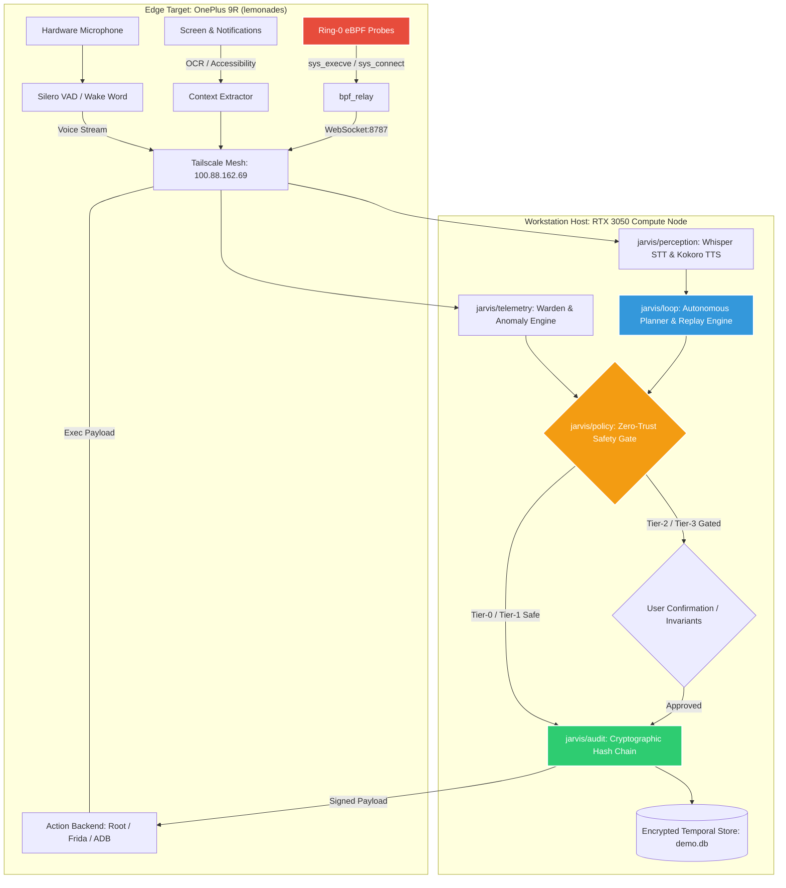

# 🧠 JARVIS-OS-9R: Autonomous Edge AI Runtime & Mobile Orchestrator

<div align="center">

[](https://www.python.org/)
[-FF0000.svg?style=for-the-badge&logo=android&logoColor=white)](https://lineageos.org/)
[](https://developer.nvidia.com/)
[](https://ebpf.io/)
[](tests/)
[](LICENSE)

**A unified, zero-trust edge runtime orchestrating mobile device autonomy, local speech perception, in-kernel telemetry, and self-improving policy execution.**

</div>

---

## 🌟 Executive Overview

**JARVIS-OS-9R** represents the convergence of autonomous mobile robotics, local AI perception, and ring-0 kernel security. Designed specifically for the **OnePlus 9R** (`lemonades`, Snapdragon 870) tethered over an encrypted **Tailscale mesh** to an **RTX 3050 workstation host**, JARVIS operates with sub-second voice loops, strict cryptographic audit chains, and in-kernel active mitigation.

Unlike cloud-dependent voice assistants or fragile user-space macro tools, JARVIS enforces:
1. **Zero-Trust Permission Tiers (Tier-0 to Tier-3):** No autonomous action touches device hardware, system files, or sensitive APIs without taint analysis and cryptographic validation.
2. **Deterministic Cryptographic Audit Trail:** Every perception, reasoning step, and device action is appended to a tamper-proof SHA-256 hash-chained ledger.
3. **Hybrid Edge-Workstation Split:** Low-latency sensor ingestion and execution run directly on the phone (<14MB RAM, <0.2% CPU); heavy neural reasoning (Ollama Qwen 2.5 7B, Whisper, Kokoro) executes on the host GPU.
4. **Ring-0 Kernel Grounding:** Telemetry does not rely on easily circumvented Android userland hooks—it hooks directly into kernel syscalls via eBPF probes.

---

## 🏛️ System Architecture



---

## 🧩 Core Subsystems

### 1. `jarvis/perception` (Low-Latency Voice & Intent)
- **Silero ONNX VAD & Audio I/O:** Real-time voice activity detection with circular streaming ring buffers.
- **Wake Word Detection:** High-accuracy local activation ("Hey JARVIS").
- **Whisper STT (`Systran/faster-whisper-small`):** Host GPU accelerated batch/streaming transcription.
- **Kokoro-82M TTS (`kokoro-v1.0.onnx`):** Natural speech synthesis (<200ms time-to-first-audio).

### 2. `jarvis/context` (Mobile Temporal Memory)
- **Device Capture:** Real-time visual screen capture, accessibility node parsing, and notification harvesting.
- **Zero-Trust Privacy Filter:** On-the-fly regex/NLP scrubbing of PII, passwords, banking credentials, and private messages.
- **Encrypted Local Store (`demo.db`):** AES-256 encrypted SQLite temporal storage with blob offloading and TTL retention policies.

### 3. `jarvis/policy` (Zero-Trust Action Safety Gate)
- **Tier Classification:**
  - **Tier-0 (Safe Read):** Read clipboard, get battery, query system time (auto-approved).
  - **Tier-1 (Reversible UI):** Launch app, tap coordinates, scroll screen, media controls.
  - **Tier-2 (State Changing):** Send notification, write non-system settings, network connections.
  - **Tier-3 (Critical / Dangerous):** Shell execution, Magisk root commands, package install/uninstall, kernel map modifications (requires explicit interactive confirmation or active token).
- **Execution Backends:** Local ADB socket, Frida runtime hooks, and Direct Root Shell (`su`).

### 4. `jarvis/loop` (Autonomous Planning & Self-Improvement)
- **Execution Engine:** Dynamic plan synthesis with backtracking and invariant validation.
- **Continuous Trajectory Curation:** Harvests successful and failed action trajectories.
- **LoRA Fine-Tuning Factory (`train_lora.py`):** Trains lightweight adapter layers from operational traces for model alignment.

### 5. `jarvis/telemetry` & `warden` (Warden Dynamic Analysis & eBPF Telemetry)
- **Ring-0 Kernel Ingestion:** Collects system-level events (`sys_execve`, `sys_connect`) via eBPF probes.
- **Frida Dynamic Agent (Warden 0.2):** High-throughput hooking across Android Java runtime and native libc (`connect`, `getaddrinfo`, `open`).
- **Telemetry Feature Extraction:** Computes Kolmogorov complexity approximations, entropy distributions, and structural burstiness.
- **Classifier & SHAP Explanations:** Trains Scikit-Learn Random Forest classifiers with calibrated probabilities and SHAP tree explainers for telemetry privacy scoring.
- **Warden CLI Subsystem:** Full suite of diagnostic and analysis tools (`jarvis warden doctor`, `capture`, `train`, `score`, `report`, `export`).

### 6. `jarvis/audit` (Cryptographic Audit & Hardening)
- **SHA-256 Merkle Ledger:** Strictly monotonic action log where any historical tampering invalidates the verification root.
- **Emergency Killswitch:** Instantaneous hardware-safe killswitch halting all automated routines and restoring safe default device states.
- **Deterministic Replay Harness:** Replay recorded incident traces to reproduce system states exactly.

### 7. `jarvis/crawl` & `jarvis_crawl` (Autonomous Mobile App Exploration)
- **Zero-Trust UI Exploration:** Autonomous app driver enforcing strict T0–T4 action safety gates (caps at T2; auto-escalates T3, strictly denies T4 dangerous controls).
- **State Identity & Deduplication:** Generates normalized structural XML tree hashes and 64-bit simhashes across Compose/Flutter and native views.
- **Event Attribution Engine:** Assigns Frida runtime hooks to specific UI actions across direct, tail, launch, and background attribution windows.
- **Trace Replay & Regression Gate:** Deterministically replays recorded UI traces (`episode.jsonl` + blobs) to verify state mutations and safety invariant enforcement.
- **Ecosystem Integration:** Direct export seam to Warden features (`features.jsonl`) for privacy classification, and sequence models (`sequences.jsonl`) for QLoRA planner training.

---

## 🚀 Quickstart & Installation

### Prerequisites
- **Host OS:** Linux (x86_64 or aarch64), Python 3.10+
- **Compute:** NVIDIA GPU with CUDA support recommended (e.g., RTX 3050, 4GB+ VRAM)
- **Mobile Device:** OnePlus 9R (`lemonades`), LineageOS 20/21 or OxygenOS 13+, Magisk Root
- **Network:** Connected to the same Tailscale tailnet

### 1. Clone & Setup Python Environment
```bash
git clone https://github.com/codeinedark77/JARVIS-OS-9R.git
cd JARVIS-OS-9R

python3 -m venv .venv
source .venv/bin/activate
pip install -e ".[all]"
```

### 2. Verify System Test Suite
Run the full verification suite (395 comprehensive unit & integration tests covering core subsystems, Warden 0.2, and Jarvis Crawl):
```bash
pytest tests/ -v
```
*Expected result: 395 passed in ~120 seconds.*

### 3. Launching JARVIS & Telemetry Analysis
```bash
# Start JARVIS in autonomous daemon mode
jarvis-os --config config/jarvis.json --device 100.88.162.69:5555

# Run the interactive policy gate CLI
python3 -m jarvis.policy.cli --interactive

# Warden 0.2 Dynamic Analysis & Device Doctor
jarvis warden doctor
jarvis warden capture --pkg com.target.app --out events.db
jarvis warden score events.db --explain

# Autonomous App Exploration & Trace Harvester
jarvis crawl selftest
jarvis crawl run --device fake --steps 50 --out traces
jarvis crawl replay traces
jarvis crawl export traces --out dataset
```

---

## 🔒 Security & Safe Operation

> [!IMPORTANT]
> **Zero Bootloop Guarantee:** JARVIS does **not** flash boot partitions or edit `/system` directly at runtime. All volatile mobile utilities operate inside `/data/local/tmp/` and the optional Magisk systemless overlay. A physical device reboot immediately reverts all transient kernel modifications.

> [!WARNING]
> **Network Screen Captures:** When orchestrating the OnePlus 9R over network ADB (`adb -s 100.x.y.z:5555`), avoid `exec-out screencap -p > local.png`. Always capture to on-device storage (`/sdcard/screencap.png`) before pulling to prevent truncated image corruption.

---

## 📄 License

This project is licensed under the MIT License - see the [LICENSE](LICENSE) file for details.
